<div align="center">


# TuitionHub

**A verified, safety-first tutoring marketplace and tuition-management platform for Bangladesh.**

Guardians and students find manually verified private tutors and coaching centres, agree on a
tuition after a demo class, and follow the teaching in one place: schedule, attendance,
homework, grades, materials and a daily class diary.

[**Live site**](https://tuitionhub-omega.vercel.app) ·
[Admin login](https://tuitionhub-omega.vercel.app/admin/login) ·
[Documentation](docs/README.md) ·
[Repository](https://github.com/Razia-rosie/Tution-Hub)


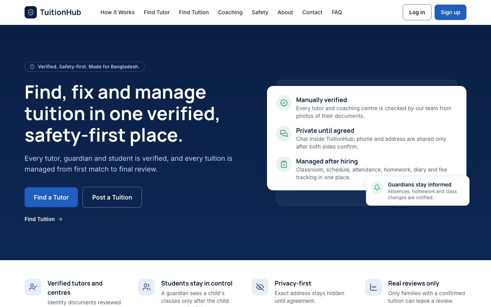

</div>

---

## Contents

[Overview](#overview) · [Live demo](#live-demo) · [Features](#features) ·
[Screenshots](#screenshots) · [Tech stack](#technology-stack) · [Architecture](#architecture) ·
[Database](#database) · [Local development](#local-development) ·
[Environment variables](#environment-variables) · [Deployment](#deployment) ·
[Testing](#testing) · [Project structure](#project-structure) · [Roadmap](#roadmap) ·
[Contributors](#contributors) · [License](#license)

## Overview

**The problem.** In Bangladesh most private tuition is arranged informally: through word of
mouth, Facebook groups and agents. Guardians rarely know whether a tutor is who they say they
are, phone numbers and home addresses are shared with strangers early, and once a tuition starts
there is no shared record of classes, attendance, homework or fees.

**What TuitionHub does.**

- Every **private tutor and coaching centre is checked by a human administrator** from pictures
  of their identity documents (and trade licence for centres) before they are listed publicly.
- Families and tutors **talk inside the platform**; phone and email are shared only after both
  sides confirm a tuition.
- After hiring, each tuition gets a **classroom** with schedule, attendance, homework and grading,
  study materials, a daily diary and fee tracking. Guardians see their own children's progress.
- Coaching centres run **teachers, students, batches, exams and fees** on the same platform.

**Who uses it.** Private tutors, coaching centres, guardians/parents, students, and platform
administrators. More in [docs/PROJECT_OVERVIEW.md](docs/PROJECT_OVERVIEW.md).

## Live demo

| | |
|---|---|
| Website | **https://tuitionhub-omega.vercel.app** |
| Admin login | https://tuitionhub-omega.vercel.app/admin/login (administrator accounts are created with a command-line tool; credentials are not published) |
| Hosting | Vercel Hobby (website + Go API) and TiDB Cloud Starter in Singapore (database). $0 per month. |

**What has been verified on the live site** (1 November 2026), using a test tutor account named
"Deploy Check":

```
Sign up → Log in → Profile → Picture upload → Submit → Admin approval → Public tutor listing
```

Before approval the profile was not visible in the public tutor list; after an administrator
approved it, it appeared in public tutor search with subject Physics and area Dhaka. The same run
checked the session cookie (`HttpOnly`, `Secure`, `SameSite=Strict`), refresh and logout, that a
picture over 4 MB is rejected, that an uploaded picture downloads byte-for-byte unchanged with
`Cache-Control: private, no-store`, and that pictures need a login. The rest of the feature set has
been verified by the automated suites against MySQL locally (see [Testing](#testing)), not
exercised on the live site.

> The public site has no demo accounts. The demo accounts in
> [docs/DEMO_ACCOUNTS.md](docs/DEMO_ACCOUNTS.md) exist only in local development databases.

## Features

Detailed list with verification levels: [docs/FEATURES.md](docs/FEATURES.md).

| Role | What they can do |
|---|---|
| **Private tutor** | Register; upload ID (and optional education certificate) pictures; submit for manual review; build a public profile with photo, subjects, classes, areas, fee and availability; search and apply to tuition posts; accept chat requests; agree demo classes and terms; run classrooms (schedule, attendance, homework, grading, materials, diary); track monthly fees; reply to reviews |
| **Coaching centre** | Register and get verified (trade licence + owner ID); manage branches, teachers, courses and a student roster; create batches with capacity and their own classroom; take attendance; set homework; create exams, enter and publish marks; generate monthly fees, record payments and send reminders; view an operational report |
| **Guardian / parent** | Link a child's student account (the child approves); post tuition needs; search verified tutors and centres; review applications; chat; request demo classes; confirm terms; follow the child's attendance, homework, grades, diary and results; mark fees paid; review the tutor |
| **Student** | Approve or refuse guardian links; post tuition needs (API); join classrooms; download materials; submit homework (picture or PDF); see scores, feedback, attendance and published coaching results |
| **Administrator** | Review verification applications with document preview, history and optional interviews; approve, reject with a reason, or request corrections; manage and suspend users; moderate tuition posts; handle support tickets and reports; see suspicious activity; grant awards; send announcements; change platform settings; read the audit log |

**Verification is manual and picture-only.** Uploads must be real JPEG, PNG or WebP images; the
server decodes them fully but never reads or scores their content. There is no OCR, face
recognition or automatic approval.

## Screenshots

All screenshots are of the current application. Public pages are from the live site; signed-in
pages use fictional demo or test data (no real people or documents).

| Live home | Live tutor search (after the approval check) |
|---|---|
|  | 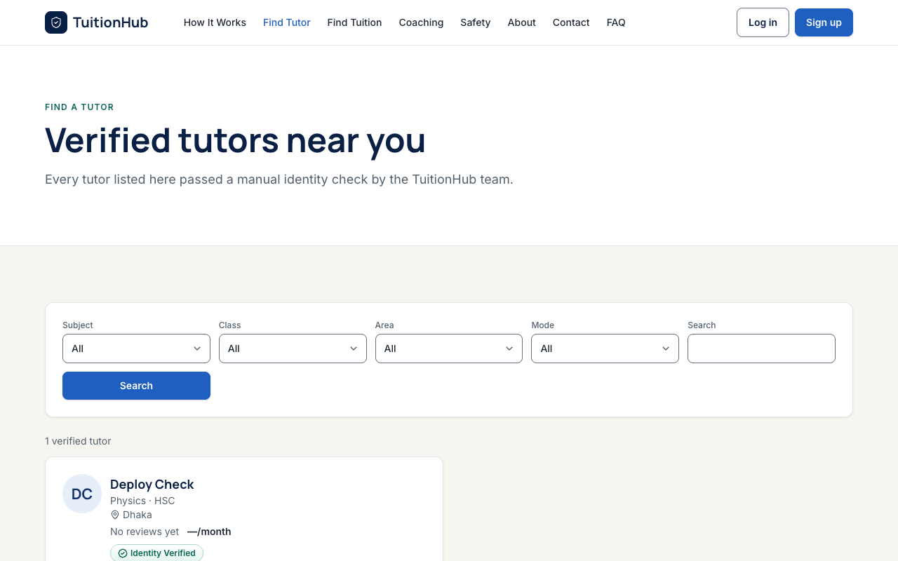 |
| **Tutor dashboard** | **Tutor: active tuition** |
| 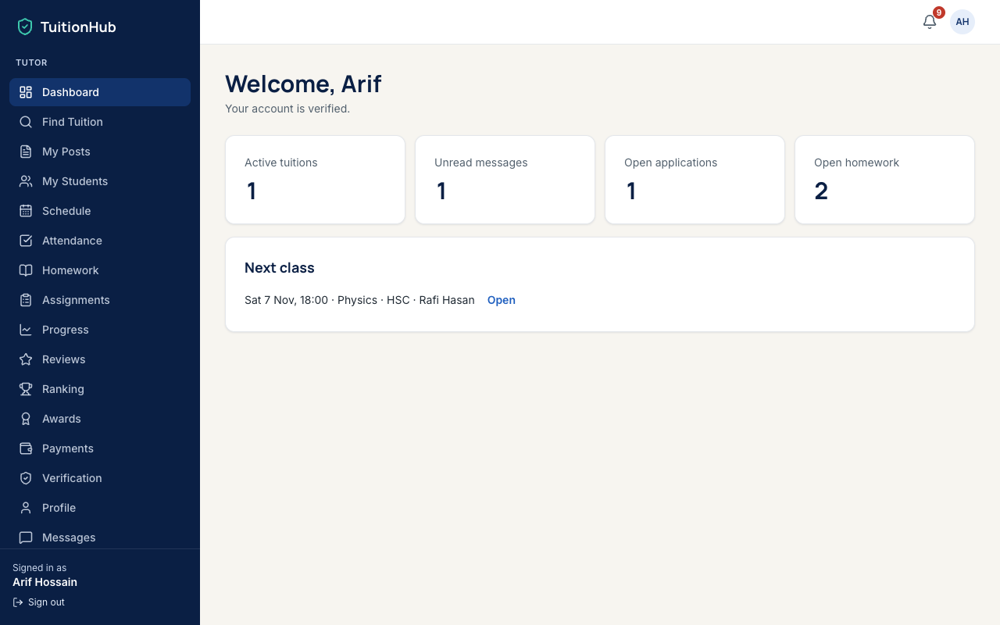 | 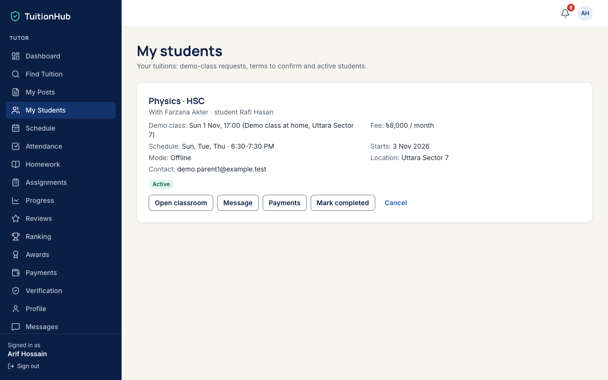 |
| **Tutor waiting for manual review** | **Student homework and grading** |
| 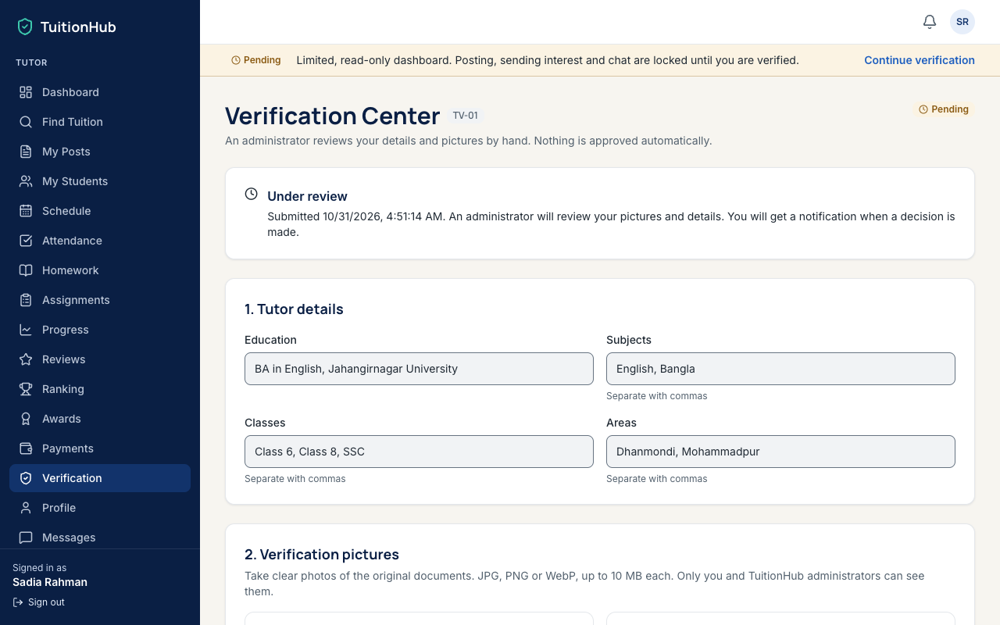 | 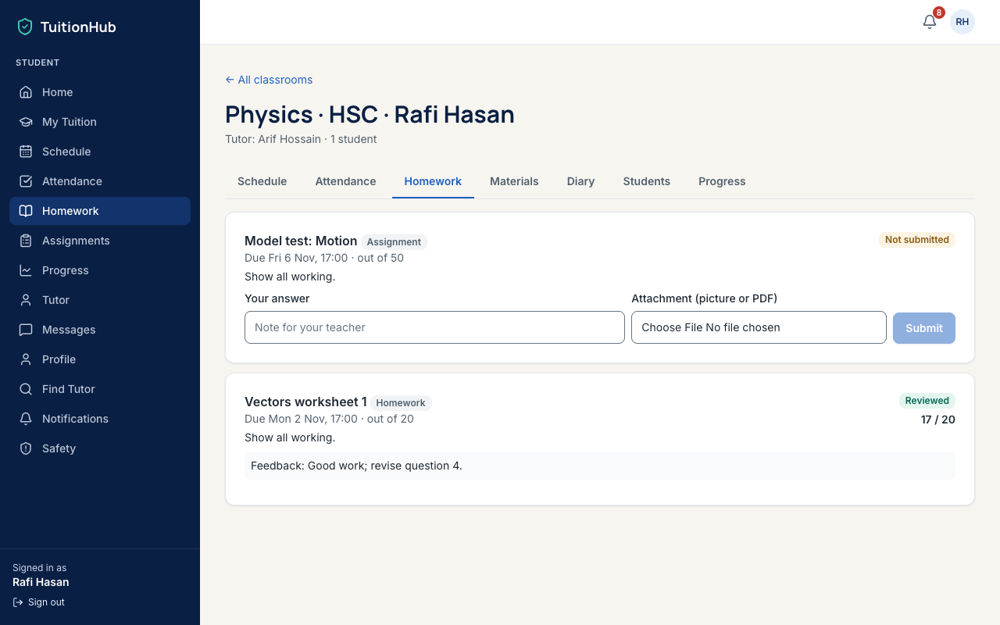 |
| **Guardian: child's progress** | **Coaching centre: batches** |
| 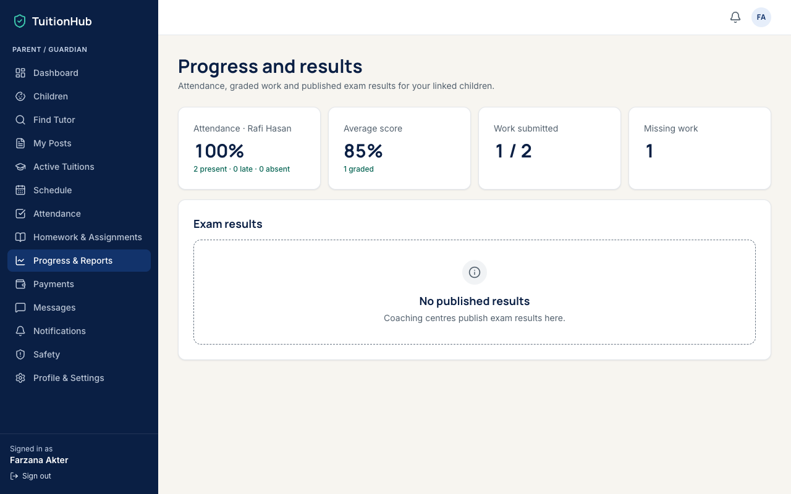 | 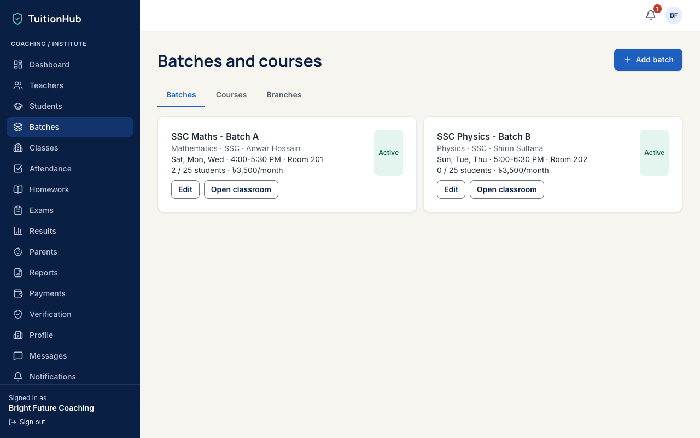 |
| **Admin overview** (test database) | **Admin verification queue** (test database) |
| 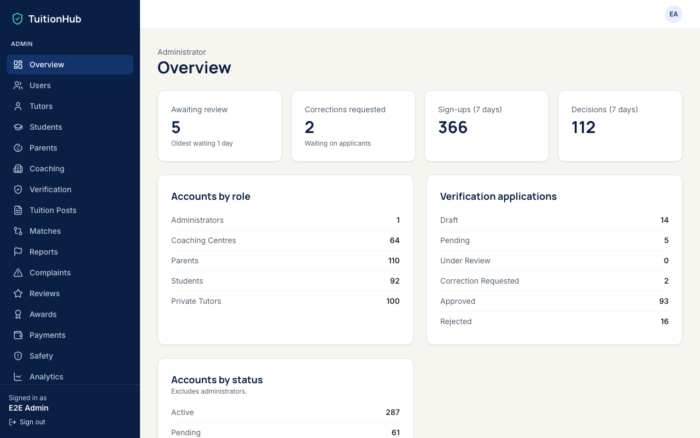 | 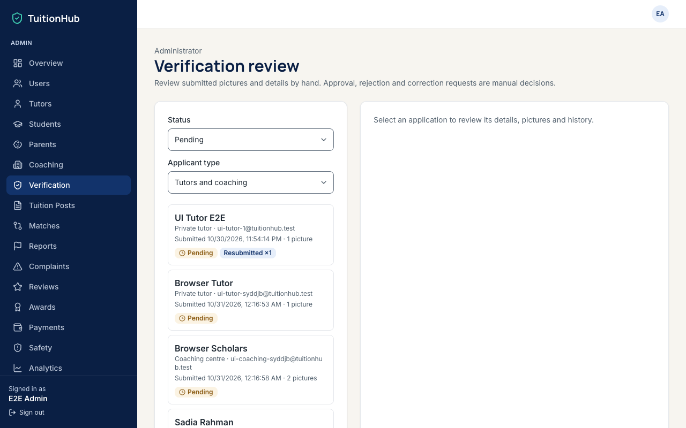 |

More: [mobile home](docs/screenshots/live-home-mobile.png), [sign-up role choice](docs/screenshots/live-signup.png),
[admin login](docs/screenshots/live-admin-login.png). Screenshots still worth adding are listed in
[docs/screenshots/README.md](docs/screenshots/README.md).

## Technology stack

| Layer | Technology |
|---|---|
| Frontend | React 19, TypeScript 5, Vite 8, Tailwind CSS 4, React Router 8, lucide-react icons |
| Backend | Go 1.25, Gin 1.11, sqlx, go-sql-driver/mysql, golang-jwt v5, bcrypt (`x/crypto`), go-playground/validator, `x/image` (WebP) |
| Database | MySQL 8.4 (local, Docker) · TiDB Cloud Starter (production, MySQL-compatible) |
| File storage | Local disk (development) or the `stored_files` database table (production) |
| Hosting | Vercel Hobby: Services (Vite site + Go server on one domain), Go runtime (Beta) |
| Testing | Go `testing` + go-sqlmock, Go integration tests, Node.js API suites, puppeteer-core browser suites |
| Tooling | pnpm 10, Node.js 22 (`.mise.toml`), Docker Compose, Air (hot reload), Make |

## Architecture

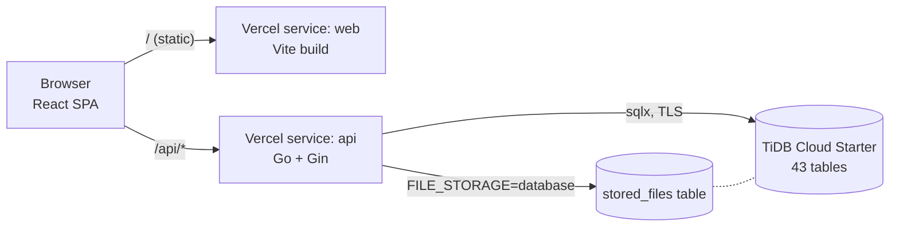

- One origin serves both the website and the API, so the session cookie stays first-party
  (`SameSite=Strict`, no CORS).
- The Go API has three modules: `auth` (accounts, sessions), `workflow` (verification and admin
  review) and `platform` (marketplace, messaging, tuitions, classrooms, coaching, administration).
- Every authenticated request re-reads the account's role and status, so suspension is immediate.
- Locally the same code runs against MySQL in Docker with uploads on disk.

Details and diagrams: [docs/ARCHITECTURE.md](docs/ARCHITECTURE.md).

## Database

- **Production:** TiDB Cloud Starter (MySQL-compatible), AWS Singapore. **Local:** MySQL 8.4 in Docker.
- **43 tables**: 42 defined in `backend/migrations/` (`001`–`005`) plus `schema_migrations`, which
  the migration runner creates. Verified on both TiDB and the local test database.
- **Schema setup:** `go run ./cmd/migrate` applies pending migrations in order. It is forward-only,
  refuses destructive statements (`DROP TABLE`, `TRUNCATE`, `DELETE FROM`) and records each file.
- **Connection:** one `DATABASE_URL` in go-sql-driver format; TiDB needs `tls=true`.

Tables, relationships and an ER diagram: [docs/DATABASE.md](docs/DATABASE.md).

## Local development

**Prerequisites:** Docker Desktop, Go 1.25, Node.js 22, pnpm 10, and Google Chrome (browser tests).

```sh
git clone https://github.com/Razia-rosie/Tution-Hub.git
cd Tution-Hub
pnpm install
make up        # MySQL + phpMyAdmin (Docker), Go API with hot reload, Vite dev server
```

| Service | URL |
|---|---|
| Website | http://localhost:5173 |
| API | http://localhost:8080/health |
| phpMyAdmin | http://localhost:8081 |

A fresh MySQL volume applies the migrations automatically. Create the first administrator with
`go run ./cmd/bootstrap-admin` and, optionally, demo accounts with `scripts/seed-demo.mjs`.

```sh
make status    # API and frontend processes
make down      # stop everything (data is kept in the Docker volume)
pnpm build     # production build of the website
```

Step-by-step guide, including existing databases and overrides: [docs/LOCAL_SETUP.md](docs/LOCAL_SETUP.md).

## Environment variables

Templates with placeholder values only: [`backend/.env.example`](backend/.env.example) (API) and
[`.env.example`](.env.example) (website build). The most important:

| Variable | Required | Purpose |
|---|---|---|
| `DATABASE_URL` | yes | MySQL/TiDB connection (go-sql-driver DSN) |
| `JWT_SECRET` | yes | At least 32 random characters; signs access tokens |
| `APP_ENV` | production | `production` hides development-only responses |
| `COOKIE_SECURE` | production | `true` behind HTTPS |
| `FILE_STORAGE` | no | `disk` (default) or `database` |
| `MAX_UPLOAD_MB` / `VITE_MAX_UPLOAD_MB` | no | Per-file upload limit (10 by default, 4 on Vercel) |
| `CLIENT_IP_HEADER` | no | `X-Real-IP` on Vercel, so rate limits see real visitors |

Full table: [docs/LOCAL_SETUP.md#environment-variables](docs/LOCAL_SETUP.md#environment-variables).

## Deployment

Production runs on **Vercel Hobby + TiDB Cloud Starter** for $0, without a payment method.
`vercel.json` defines two services (the Vite site and the Go API); environment variables are set
in the Vercel project; the schema is applied from a developer machine with `cmd/migrate`.

Steps, limits, verification checklist and troubleshooting: [docs/DEPLOYMENT.md](docs/DEPLOYMENT.md).

## Testing

| Check | Latest result |
|---|---|
| Go unit tests (`go test ./...`, 7 packages) | pass |
| Go integration tests (isolated `_e2e` database) | pass |
| API suite `tests/verification-e2e.mjs` | 119 / 119 |
| API suite `tests/platform-e2e.mjs` | 169 / 169 |
| Browser suite `tests/browser-e2e.mjs` | 60 / 60 |
| Browser suite `tests/journeys-browser.mjs` | 34 / 34 |
| `gofmt`, `go vet`, `tsc --noEmit`, `pnpm build` | clean |
| Live deployment checks | 12 / 12, plus the admin approval check |

The formal Software Test Report (128 specified cases, 115 passed, 2 failed, 2 blocked, 9 not
tested; core statement coverage 45.2%) is in [reports/](reports/test-results-summary.md).
How to run everything: [docs/TESTING.md](docs/TESTING.md).

## Project structure

```
src/                      React frontend
  pages/                  public pages, auth pages, admin screens, RolePage (role → screen)
  features/               feature screens shared by roles (marketplace, messages, classrooms…)
  components/             app shell, UI kit, verification centre
  lib/                    API clients, session handling, navigation, upload limit
backend/
  cmd/server              API entry point
  cmd/migrate             forward-only migration runner
  cmd/bootstrap-admin     creates the first administrator
  internal/auth           accounts, passwords, JWT, refresh sessions, rate limits
  internal/workflow       verification, documents, admin review, notifications
  internal/platform       marketplace, messaging, tuitions, classrooms, coaching, admin
  internal/filestore      upload storage (disk or database)
  internal/integration    integration tests (isolated database only)
  migrations/             001–005 SQL migrations
tests/                    API and browser end-to-end suites and fixtures
scripts/                  development-only demo-account seed
docs/                     documentation and screenshots
reports/                  Software Test Report and test evidence
vercel.json               Vercel services configuration
Makefile                  local development commands
```

## Roadmap

Not implemented yet (see [docs/KNOWN_ISSUES.md](docs/KNOWN_ISSUES.md)):

- Email delivery for password reset and email verification (no provider configured)
- SMS/OTP and online payments (fees are tracked, not collected)
- Real-time push for messages and notifications (currently polling)
- Logins for coaching teachers; a student tuition-posting screen (the API exists)
- Review moderation, pagination on long lists, CI pipeline, higher test coverage

## Contributors

| Name | Role |
|---|---|
| [Razia Rosie](https://github.com/Razia-rosie) | Project owner and author of all commits |

Commit trailers record that development was assisted by Claude (Anthropic), an AI coding assistant.

## License

This repository does **not** have an open-source license yet. Without one, the default copyright
rules apply: you may view the code on GitHub, but reuse, modification and distribution are not
granted. Add a `LICENSE` file if you want to allow that.

---

[Contributing](CONTRIBUTING.md) · [Security policy](SECURITY.md) · [Changelog](docs/CHANGELOG.md)
