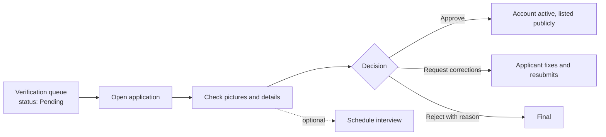

# Administrator guide

Administrators verify tutors and coaching centres and run the platform. Admin login:
https://tuitionhub-omega.vercel.app/admin/login (local: http://localhost:5173/admin/login).

## Creating an administrator

Administrators cannot sign up through the website. The first one is created from the command line,
against the target database, from `backend/`:

```sh
read -r -s ADMIN_BOOTSTRAP_PASSWORD && export ADMIN_BOOTSTRAP_PASSWORD
DATABASE_URL='...' JWT_SECRET='...' go run ./cmd/bootstrap-admin -name "Your Name" -email "you@example.com"
unset ADMIN_BOOTSTRAP_PASSWORD
```

The command refuses to run if an administrator already exists or the email is taken, so it never
changes an existing password. To change your password later, use **Forgot password** (works only
where the server can show the link, i.e. development, until an email provider is configured).

Never share administrator credentials or store them in the repository.

## Verification review



1. Open **Verification**. Filter by status (Pending by default) and applicant type.
2. Select an application. You see the submitted details, every picture, the history and a
   "Resubmitted ×N" flag if it came back after corrections.
3. Compare the pictures with the details: name, document type, legibility; for centres, the trade
   licence and the owner's ID.
4. Decide:
   - **Approve:** the account becomes active and the profile is listed publicly.
   - **Request corrections:** write what must change; the applicant can edit and resubmit.
   - **Reject:** write the reason; the decision is final.
   - **Schedule interview** (optional) and record its outcome.
5. The applicant is notified. Every document view and decision is written to the audit log.

Decisions are always manual: the system never inspects document content or approves automatically.

## Other admin screens

| Screen | What it is for |
|---|---|
| **Overview** | Queue size, corrections pending, sign-ups and decisions in the last 7 days, accounts by role and status |
| **Users / Tutors / Students / Parents / Coaching** | Search accounts, open details and activity, **suspend** (ends all sessions immediately) or reactivate. Administrators cannot be suspended from the UI |
| **Tuition Posts** | Close posts with a reason (the owner cannot reopen them) |
| **Matches** | Tuition agreements across the platform |
| **Reports / Complaints / Appeals** | Support tickets by category; resolve with a resolution note (the reporter is notified) |
| **Reviews / Payments** | Read-only overviews of reviews and fee records |
| **Awards** | Grant awards to tutors (shown on their public profile) |
| **Safety** | Suspicious activity: repeated failed logins, multiple reports |
| **Analytics** | Period reports with CSV export |
| **Settings** | Open or close registrations and tutor applications, maximum applications per tutor per day, maintenance banner, support email; send announcements to a role |
| **Audit Log** | Uploads, document views, decisions, suspensions and other sensitive actions |

## Good practice

- Review pictures only inside TuitionHub; do not download or forward identity documents.
- Write clear correction notes and rejection reasons: applicants see them.
- Suspend first and investigate; suspension is reversible.
- Test accounts on the live site (for example "Deploy Check") can be suspended once checks are done.
