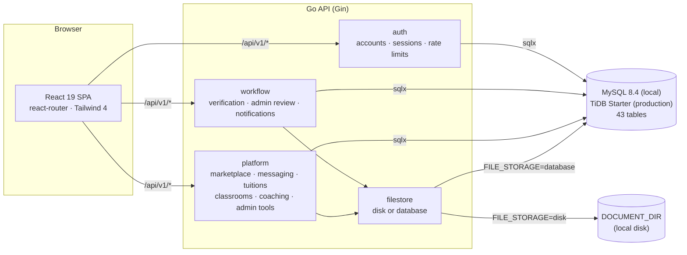
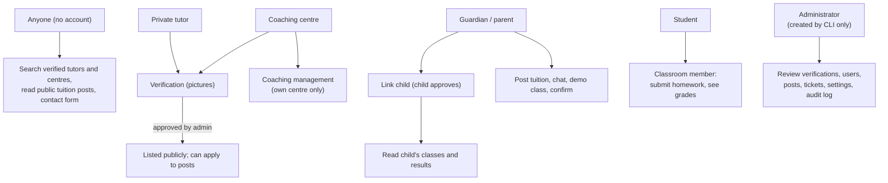

# Architecture

## Overview

| Environment | Website | API | Database | Uploads |
|---|---|---|---|---|
| Local (`make up`) | Vite dev server `:5173`, proxies `/api` to `:8080` | Go + Air hot reload `:8080` | MySQL 8.4 in Docker | Disk (`DOCUMENT_DIR`) |
| Production | Vercel service `web` (static build) | Vercel service `api` (Go runtime), region `sin1` | TiDB Cloud Starter, Singapore | `stored_files` table |

In both, the browser talks to a single origin, so the session cookie stays first-party.

## User roles and permissions

## Request lifecycle (backend)

1. `cmd/server/main.go` loads configuration (`internal/config`), waits for MySQL, builds a Gin
   router with logging, panic recovery and trusted-proxy settings, and registers three route
   groups under `/api/v1`: `auth`, `workflow`, `platform`.
2. Authenticated routes use `auth.RequireAuth`: it validates the JWT, then loads the account's
   role and status from the database on every request (suspended accounts get 403). Public
   routes use `auth.OptionalAuth`, which identifies the caller when a valid token is sent.
3. Handlers bind and validate input (`go-playground/validator`), call a service method, and map
   errors to HTTP statuses. Unknown errors are logged with request context and returned as a
   generic 500.
4. Services run parameterised SQL through `sqlx`, using transactions for multi-step state
   changes (verification decisions, tuition activation, suspension).
5. Side effects — notifications and audit-log entries — are written alongside the change.

## Backend modules

| Package | Responsibility |
|---|---|
| `internal/config` | Environment variables with defaults and validation |
| `internal/database` | Connection pool settings and wait/retry |
| `internal/filestore` | Upload storage behind one interface: `Disk` (files under `DOCUMENT_DIR`) or `Database` (`stored_files` table) |
| `internal/auth` | Users, bcrypt passwords, JWT access tokens, rotating refresh tokens (body or httpOnly cookie), password reset, email-verification tokens, rate limits, `RequireAuth` / `OptionalAuth`, admin bootstrap |
| `internal/ratelimit` | In-memory fixed-window limiter |
| `internal/workflow` | Verification applications and documents (image validation, upload limit), profile, dashboard, notifications, admin review/interviews, admin users/stats/audit log |
| `internal/platform` | Public discovery, tuition posts and applications, guardian links, chat requests, conversations, tuition agreements, payments, reviews, classrooms, coaching management, support tickets, platform settings and admin tools |
| `internal/integration` | Integration tests against a real `*_e2e` database |
| `cmd/migrate` | Forward-only migration runner (MySQL and TiDB) |
| `cmd/bootstrap-admin` | Creates the first administrator |

## Frontend structure

| Path | Responsibility |
|---|---|
| `src/routes.tsx` | Router: public pages, auth pages, `/app/:role/:page/*` |
| `src/components/AppShell.tsx` | Signed-in shell: role guard, sidebar navigation, notification badge, verification banner |
| `src/pages/RolePage.tsx` | Maps each role's navigation slug to a feature screen; lazy-loads feature modules |
| `src/lib/nav.ts` | Navigation items per role |
| `src/features/` | Feature screens shared across roles: `Marketplace`, `Messages`, `Tuitions`, `Classrooms`, `People` (profile, children, progress, reviews, dashboard, safety), `Coaching` |
| `src/pages/admin/` | Admin screens (overview, users, verification, audit, platform tools) |
| `src/pages/auth/`, `src/pages/public/`, `src/pages/Landing.tsx` | Sign-in/sign-up/recovery and public pages |
| `src/lib/api.ts` | Auth calls, session handling (in-memory access token, cookie refresh), generic `api` helper |
| `src/lib/platform.ts` | Typed client for the platform endpoints |
| `src/lib/store.tsx` | React context: session, sign-up draft, verification banner state, toasts |
| `src/lib/useLoad.ts` | Data loading with stale-response protection; action helper with toasts |
| `src/lib/uploads.ts` | Per-file upload limit (`VITE_MAX_UPLOAD_MB`) |
| `src/components/ui.tsx` | Shared UI primitives |

Domain data is never cached in global state: each screen loads what it shows from the API.
Real-time updates use polling (open conversations every 4 s).

## Design decisions

- **One backend, three modules.** Verification predates the platform module and keeps its own
  routes under `/workflow`; newer features live in `internal/platform`.
- **Manual verification only.** Uploaded pictures are evidence for a human reviewer; nothing
  inspects their content beyond validating that they are real images.
- **Additive migrations.** The runner refuses destructive statements so it can be pointed at a
  database with real users.
- **Pluggable file storage.** Uploads get random UUID keys and are served only through authorised
  endpoints. On a single server they live on disk (`0600` permissions); on serverless hosting,
  which has no persistent disk, they live in the `stored_files` table (`FILE_STORAGE=database`).
- **Same code locally and in production.** Hosting differences are configuration only (`PORT`,
  `FILE_STORAGE`, `MAX_UPLOAD_MB`, `CLIENT_IP_HEADER`); see [DEPLOYMENT.md](DEPLOYMENT.md).
