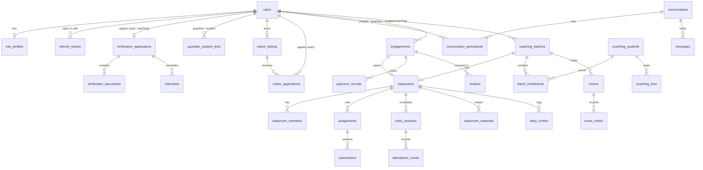

# Database

| | Local development | Production |
|---|---|---|
| System | MySQL 8.4 (Docker image `mysql:8.4`) | TiDB Cloud Starter v8.5 (MySQL-compatible) |
| Hosting | `backend/docker-compose.yml` | AWS Singapore (`ap-southeast-1`) |
| Connection | `DATABASE_URL` without TLS | `DATABASE_URL` with `tls=true`, port 4000 |

Conventions: `utf8mb4`, InnoDB, UUID primary keys (`CHAR(36)`), UTC timestamps (`DATETIME(6)`).
Schema files: `backend/migrations/`.

**Table count: 43** — 42 tables created by the migrations plus `schema_migrations`, created by the
runner. Verified on 1 Nov 2026 on TiDB (43 tables, 360 columns, 82 foreign keys) and on the local
MySQL test database (identical counts).

## Connecting

`DATABASE_URL` uses the go-sql-driver DSN format:

```text
USER:PASSWORD@tcp(HOST:PORT)/tuitionhub?parseTime=true&charset=utf8mb4&loc=UTC        # MySQL
USER:PASSWORD@tcp(HOST:4000)/tuitionhub?parseTime=true&charset=utf8mb4&loc=UTC&tls=true  # TiDB
```

Keep `parseTime=true&charset=utf8mb4&loc=UTC`. Never commit a real connection string; locally use
`backend/.env.local` (git-ignored), in production the hosting platform's secret settings.

## Initialising safely

1. Take a backup if the database already holds data.
2. From `backend/`: `DATABASE_URL="...&multiStatements=true" go run ./cmd/migrate -dry-run` to list
   pending files, then without `-dry-run` to apply them.
3. Create the first administrator with `go run ./cmd/bootstrap-admin` ([LOCAL_SETUP.md](LOCAL_SETUP.md)).

A new local Docker volume applies `001`–`005` automatically on first start.

## Migrations

| File | Adds |
|---|---|
| `001_auth.sql` | `users`, `refresh_tokens`, `auth_tokens` |
| `002_workflows.sql` | admin role and `account_status`, `role_profiles`, verification tables, `interviews`, `guardian_student_links`, `notifications`, `audit_logs`, `tuition_listings` |
| `003_platform.sql` | marketplace, messaging, tuition agreements, classrooms, coaching, reviews, payments, support, settings; extra profile and listing columns; indexes |
| `004_session_ids.sql` | `refresh_tokens.session_id`, so logout, password reset and suspension end a session's access tokens immediately |
| `005_stored_files.sql` | `stored_files` (uploaded file contents when `FILE_STORAGE=database`) |

Rules:

- Migrations are **additive**. `003`–`005` use `CREATE TABLE IF NOT EXISTS` and guards every new column
  and index with an `information_schema` check, so it is safe to re-run.
- Apply with `go run ./cmd/migrate` from `backend/` after taking a backup ([LOCAL_SETUP.md](LOCAL_SETUP.md)).
  The runner records versions in `schema_migrations`, baselines databases created before it
  existed, warns when an applied file has changed, and refuses destructive statements. It runs
  each file as one multi-statement batch and rewrites the `SELECT IF(...) INTO @var` guards into the
  equivalent `SET @var = (SELECT IF(...))`, which TiDB requires and MySQL also accepts.
- New schema changes go in a new numbered file; never edit an applied file.

## Tables

### Accounts and verification

| Table | Purpose | Key constraints |
|---|---|---|
| `users` | All accounts | `email` unique; `role` enum (tutor, student, parent, coaching, admin); `account_status` enum |
| `refresh_tokens` | Rotating refresh tokens (SHA-256 hashes) | `token_hash` unique; FK user (cascade) |
| `auth_tokens` | Password-reset and email-verification tokens (hashed) | FK user (cascade) |
| `role_profiles` | One profile per user (subjects, classes, areas as JSON; fee, bio, photo, listing flag…) | PK = user id; `completion_percent` |
| `verification_applications` | One application per tutor/coaching user | `user_id` unique; status draft → pending → decided |
| `verification_documents` | Uploaded pictures (storage key, MIME, size, sha256) | unique (application, document_type) |
| `interviews` | Optional verification interviews | FK application (cascade); `scheduled_by` (no action) |

### Marketplace and social

| Table | Purpose | Key constraints |
|---|---|---|
| `tuition_listings` | Tuition posts by parents/students | status open/paused/filled/closed; `student_id` has no FK |
| `tuition_applications` | Tutor applications | unique (listing, tutor) |
| `saved_listings` | Tutor bookmarks | PK (user, listing) |
| `guardian_student_links` | Parent ↔ student, approved by the student | unique (guardian, student); pending/approved/rejected/revoked |
| `connection_requests` | Chat requests | status pending/accepted/declined/cancelled |
| `conversations`, `conversation_participants`, `messages` | Persistent messaging | participant PK (conversation, user) with `last_read_at` |
| `user_blocks` | Blocks | PK (blocker, blocked) |
| `notifications` | Per-user notifications | index (user, created_at) |
| `audit_logs` | Append-only audit trail | indexes on subject, action and time |

### Tuition agreements

| Table | Purpose | Key constraints |
|---|---|---|
| `engagements` | Demo class → terms → active → completed/cancelled | two confirmation timestamps |
| `payment_records` | Monthly fee tracking | unique (engagement, month) |
| `reviews` | Reviews of tutors | unique (engagement, reviewer); `CHECK stars BETWEEN 1 AND 5` |
| `awards` | Admin-granted awards | FK user |

### Classrooms

| Table | Purpose | Key constraints |
|---|---|---|
| `classrooms` | Tutor classroom (one per tuition) or batch classroom | `engagement_id` unique |
| `classroom_members` | Student accounts in a classroom | PK (classroom, student) |
| `classroom_materials` | Notes, links and files | |
| `assignments`, `submissions` | Homework and hand-ins | submission unique (assignment, student) |
| `class_sessions` | Scheduled classes | status scheduled/held/cancelled/rescheduled |
| `attendance_marks` | Attendance | PK (session, learner_kind, learner_id); `learner_kind` user or roster (polymorphic, no FK on learner) |
| `diary_entries` | Daily class diary | unique (classroom, entry_date) |

### Coaching

| Table | Purpose |
|---|---|
| `coaching_branches`, `coaching_teachers`, `coaching_courses` | Centre organisation |
| `coaching_students` | Roster; optional links to a student and a guardian account |
| `coaching_batches` | Batches (each linked to a classroom) |
| `batch_enrollments` | Roster ↔ batch |
| `exams`, `exam_marks` | Exams; marks locked after publishing (enforced in code) |
| `coaching_fees` | Monthly fees, unique (student, month) |

### Platform

| Table | Purpose |
|---|---|
| `support_tickets` | Support requests, complaints, reports, appeals; reporter nullable for anonymous contact |
| `platform_settings` | Admin settings (JSON values, typed whitelist in code) |
| `stored_files` | Uploaded file contents (key, MIME type, size) when `FILE_STORAGE=database` |
| `schema_migrations` | Applied migration versions (created by the runner) |

## Entity relationships (main tables)



Not shown: `auth_tokens`, `saved_listings`, `connection_requests`, `user_blocks`, `notifications`,
`audit_logs`, `awards`, `coaching_branches`, `coaching_teachers`, `coaching_courses`,
`support_tickets`, `platform_settings`, `stored_files`, `schema_migrations`.

## Deletion behaviour

Deleting a user cascades to their owned records (profile, tokens, posts, classrooms they own,
coaching data). Authored content elsewhere keeps the row with the author set to `NULL`
(messages, materials, audit logs). Deleting an administrator who scheduled interviews fails
because `interviews.scheduled_by` has no `ON DELETE` action.

## Integrity checks

`backend/internal/integration` asserts invariants on the test database, for example: decided
applications have a reviewer and time, no documents without an application, suspended users have
no live refresh tokens, document hashes are well formed.
