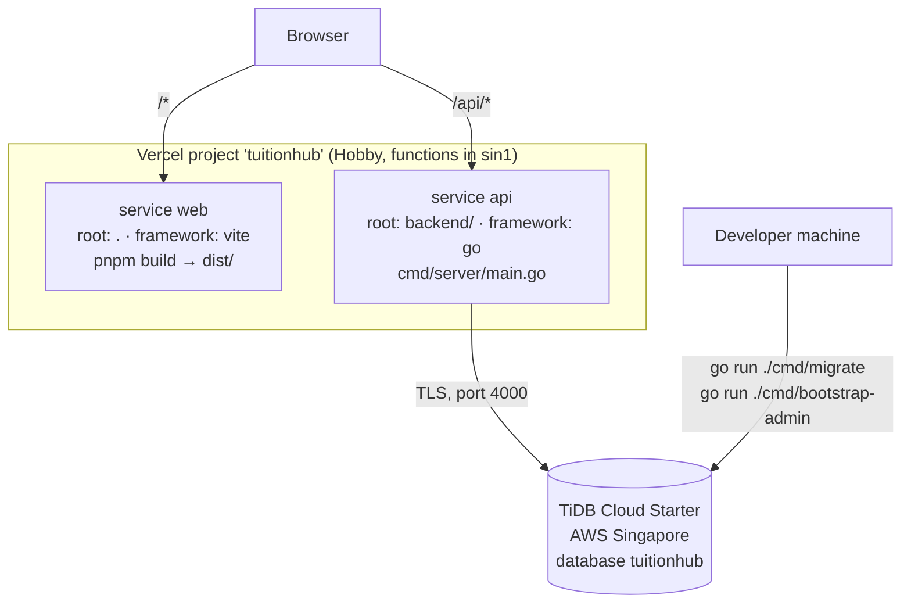

# Deployment

TuitionHub is deployed at **https://tuitionhub-omega.vercel.app** on **Vercel Hobby** (website and
Go API) with **TiDB Cloud Starter** (database), for $0 per month and without a payment method.
Limits below were checked against the providers' documentation in October 2026; free tiers change,
so re-check the linked pages.

## Architecture



`vercel.json` defines the two services and routes `/api/*` to the Go service and everything else to
the website, so both share one origin and the `SameSite=Strict` session cookie works without CORS.

## Free limits and what happens when they run out

| Provider | Free allowance | When exceeded | Docs |
|---|---|---|---|
| Vercel Hobby | 4 Active CPU-hours, 360 GB-hours memory, 1M invocations, 100 GB data transfer per month; 300 s per request; **4.5 MB** request/response body | No charge; the feature pauses until 30 days pass | [Hobby](https://vercel.com/docs/plans/hobby), [function limits](https://vercel.com/docs/functions/limitations), [Go runtime](https://vercel.com/docs/functions/runtimes/go), [Services](https://vercel.com/docs/services) |
| TiDB Cloud Starter | 5 GiB row storage and 50M Request Units per instance per month (up to 5 free instances); 400 connections | Throttled, new connections refused until next month; no charge with a $0 spending limit | [pricing](https://www.pingcap.com/tidb-cloud-starter-pricing-details/), [limits](https://docs.pingcap.com/tidbcloud/serverless-limitations/) |

- **Sleeping:** the API runs as Vercel Functions (Fluid compute) and scales to zero when idle, so
  the first request after a quiet period is slower.
- **Persistence:** all data, including uploaded pictures (`FILE_STORAGE=database`), is in TiDB.
  Vercel Functions have no persistent disk.
- **Hobby is for non-commercial, personal use.** The Go runtime and Services are in Beta.

## Production configuration

Vercel project `tuitionhub` (team `rosie`), framework preset **Services**, Node.js 22, function
region `sin1` (Singapore), Deployment Protection: Standard (preview URLs need a Vercel login; the
production domain is public).

| Variable | Value | Type |
|---|---|---|
| `DATABASE_URL` | `USER:PASSWORD@tcp(HOST:4000)/tuitionhub?parseTime=true&charset=utf8mb4&loc=UTC&tls=true` | Sensitive |
| `JWT_SECRET` | 48+ random characters, unique to production | Sensitive |
| `APP_ENV` | `production` | Plain |
| `COOKIE_SECURE` | `true` | Plain |
| `FILE_STORAGE` | `database` | Plain |
| `MAX_UPLOAD_MB` | `4` | Plain |
| `VITE_MAX_UPLOAD_MB` | `4` | Plain |
| `CLIENT_IP_HEADER` | `X-Real-IP` | Plain |

`X-Real-IP` is safe to trust on Vercel because Vercel overwrites it with the real client address.

## Setting it up from scratch

### 1. Database (TiDB Cloud, no card)

1. Sign up at [tidbcloud.com](https://tidbcloud.com).
2. **Create Resource → Starter**, MySQL compatible, AWS **Singapore**, monthly spending limit **$0**.
3. In the SQL Editor: `CREATE DATABASE IF NOT EXISTS tuitionhub;`
4. **Connect → Generate Password**; note HOST, USERNAME and PASSWORD privately (never in chat,
   issues or commits). Build `DATABASE_URL` as in the table above.

### 2. Schema and first administrator (from your machine)

From `backend/`, with the values kept in a git-ignored file or your shell only:

```sh
read -r -s DATABASE_URL && export DATABASE_URL
DATABASE_URL="$DATABASE_URL&multiStatements=true" go run ./cmd/migrate

read -r -s ADMIN_BOOTSTRAP_PASSWORD && export ADMIN_BOOTSTRAP_PASSWORD
JWT_SECRET="$(openssl rand -base64 48)" go run ./cmd/bootstrap-admin -name "Your Name" -email "you@example.com"
unset ADMIN_BOOTSTRAP_PASSWORD DATABASE_URL
```

The migration runner rewrites the migrations' `SELECT ... INTO @var` guards (unsupported by TiDB)
into the equivalent `SET @var = (SELECT ...)` at run time, so the same files work on MySQL and TiDB.
**Never load the demo accounts into production**: their passwords are public.

### 3. Vercel

1. Create a project (do not reuse a project that serves another repository) and import
   `Razia-rosie/Tution-Hub`. The framework preset becomes **Services** from `vercel.json`.
2. **Settings → Functions → Region:** `sin1` (same region as TiDB).
3. **Settings → Environment Variables:** add the table above for Production and Preview; mark
   `DATABASE_URL` and `JWT_SECRET` as Sensitive.
4. Deploy (push to the production branch, or redeploy from the dashboard).

## Verifying a deployment

```sh
curl -s https://tuitionhub-omega.vercel.app/api/v1/public/info   # JSON, HTTP 200
```

Then in the browser: sign up as a tutor, upload an ID picture under 4 MB, submit, approve it from
`/admin/login`, and check that the tutor appears in **Find Tutor**. In developer tools the
`th_refresh` cookie must be `HttpOnly`, `Secure` and `SameSite=Strict`.

**Last verified (1 Nov 2026):** the API returned 200 from TiDB; sign-up, login, cookie flags,
refresh, profile save, picture upload (stored in TiDB), rejection of a picture over 4 MB, identical
download with `private, no-store`, submission, 401 without login, hidden-before-approval, logout,
and an administrator approval that made the tutor appear in public search all worked.

## Troubleshooting

| Symptom | Cause and fix |
|---|---|
| `/api/...` returns `FUNCTION_INVOCATION_FAILED` (500) | The API exits at start-up, usually because `DATABASE_URL` or `JWT_SECRET` (≥ 32 chars) is missing. Check the variables, then redeploy: new variables apply only to new deployments. |
| `Access denied for user` in the function logs | Wrong TiDB user or password, or the password was reset. Update `DATABASE_URL` and redeploy. |
| TLS or `x509` errors | `DATABASE_URL` is missing `tls=true`. |
| Migration fails with a syntax error near `@sql` | An old migration runner without the TiDB rewrite; update to the current `backend/cmd/migrate`. |
| Uploads fail with HTTP 413 | The file exceeds Vercel's 4.5 MB body limit; keep `MAX_UPLOAD_MB=4` and `VITE_MAX_UPLOAD_MB=4`. |
| Everyone is rate-limited together | `CLIENT_IP_HEADER` is not set to `X-Real-IP`, so all visitors share one address. |
| Users are signed out on every reload | `COOKIE_SECURE=true` over plain HTTP, or the API is served from a different origin than the site. |
| The site works but the API is slow at first | Cold start after idle; normal on the free tier. |
| Database refuses new connections | The TiDB monthly free quota is used up; it resets next month. |

## Not covered by this deployment

- Email delivery (password reset, email verification): no provider is configured.
- Backups: export TiDB data periodically if it matters.
- Search-engine indexing is disabled (`robots.index: false` in `.figma/make/site.json`).
- Commercial use requires a paid Vercel plan.

## Running elsewhere

The API is a single Go binary (`backend/Dockerfile`) configured by environment variables, so it
can also run on any container host with MySQL 8 or TiDB. Requirements: HTTPS, the site and `/api`
on the same origin, `TRUSTED_PROXIES` (or `CLIENT_IP_HEADER`) for the proxy, persistent storage for
`DOCUMENT_DIR` when `FILE_STORAGE=disk`, and backups.
