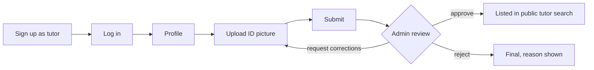
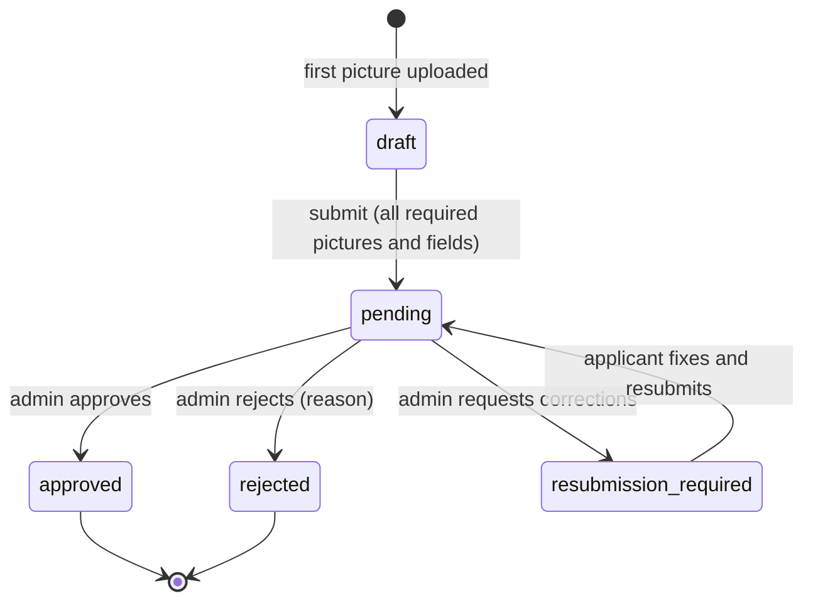

# Features

Every feature below is implemented in the current code. The **Verified** column says how:

- **Live**: exercised on the deployed site (https://tuitionhub-omega.vercel.app) on 1 Nov 2026.
- **Automated**: covered by the API and browser suites run locally against MySQL
  ([TESTING.md](TESTING.md)); not exercised on the live site.
- **API only**: implemented and tested through the API, without a dedicated screen.
- **Not implemented**: listed for completeness; see [KNOWN_ISSUES.md](KNOWN_ISSUES.md).

## Verified live workflow

A test tutor, "Deploy Check", went through this flow on the live site. It was **not** listed before
approval; after approval it appeared in public tutor search with subject Physics and area Dhaka.

## Accounts and sessions (all roles)

| Feature | Verified |
|---|---|
| Sign up as tutor, coaching centre, guardian or student (admins cannot sign up) | Live (tutor), Automated (all) |
| Log in; session survives page reloads; log out | Live |
| Refresh token in an `HttpOnly; Secure; SameSite=Strict` cookie, access token in memory | Live |
| Rate limits on login, sign-up and token requests | Automated |
| Forgot / reset password and email verification | Automated in development mode; **email is not sent** in production (no provider) |
| Notifications with unread badge | Automated |
| Suspension takes effect immediately | Automated |

## Private tutor

| Feature | Verified |
|---|---|
| Verification: upload identity picture (required) and education picture (optional), JPEG/PNG/WebP | Live |
| Submit for review; reviewed fields locked while pending; resubmit after a correction request | Live (submit), Automated (resubmit) |
| Public profile: photo, bio, subjects, classes, areas, fee, teaching modes, availability | Live (basic fields), Automated (all) |
| Listed in public search only after approval | Live |
| Search tuition posts, save posts, apply (verified tutors only) | Automated |
| Accept or decline chat requests; messaging with unread counts; block and report | Automated |
| Demo class → propose terms → both confirm → active tuition with classroom | Automated |
| Classroom: weekly schedule, cancel/reschedule, attendance, homework and assignments, grading with feedback, materials (picture/PDF/link), daily diary | Automated |
| Monthly fee records; confirm receipt | Automated |
| Reviews from families; reply | Automated |
| Ranking within subject and admin-granted awards | Automated |

## Coaching centre

| Feature | Verified |
|---|---|
| Verification with trade licence and owner ID pictures | Automated |
| Branches, teachers, courses | Automated |
| Student roster, optionally linked to student and guardian accounts | Automated |
| Batches with capacity; each batch gets a classroom; enrol / remove students | Automated |
| Batch attendance (roster students), homework | Automated |
| Exams; mark entry; publishing locks marks and notifies | Automated |
| Monthly fee generation from batch fees; mark paid; remind guardian | Automated |
| Operational report (students, batches, attendance, fees, exams) | Automated |
| Public centre page after approval | Automated |

## Guardian / parent

| Feature | Verified |
|---|---|
| Link a child by the child's student-account email; the child approves | Automated |
| Post tuition needs for a linked child; review, shortlist and accept applications | Automated |
| Search verified tutors and coaching centres | Automated |
| Send chat requests; message tutors | Automated |
| Request a demo class; confirm terms | Automated |
| Read the child's classroom (schedule, attendance, homework, diary) as a viewer | Automated |
| Progress summary and published coaching results | Automated |
| Absence and homework notifications | Automated |
| Mark fees paid or dispute; review the tutor | Automated |

## Student

| Feature | Verified |
|---|---|
| Approve or refuse guardian links | Automated |
| Join classrooms when a tuition is confirmed or a centre enrols them | Automated |
| Download materials; submit homework with a picture or PDF; see score and feedback | Automated |
| Attendance, progress and published results | Automated |
| Post tuition needs | API only (posting screen exists for parents only) |

## Administrator

| Feature | Verified |
|---|---|
| Verification queue with document preview, history, resubmission flag | Live (approve), Automated |
| Approve, reject with reason, request corrections; optional interviews | Live (approve), Automated |
| Users: search, detail with activity, suspend and reactivate | Automated |
| Tuition-post moderation (close with reason) | Automated |
| Support tickets, reports and complaints with resolution notes | Automated |
| Suspicious activity (repeated failed logins, multiple reports) | Automated |
| Reviews and payments overview; awards; announcements to a role | Automated |
| Platform settings (registrations open, tutor applications open, maintenance banner) | Automated |
| Audit log of uploads, document views, decisions, suspensions | Automated |
| Period reports | Automated (the CSV download button itself is not covered by a test) |

## How the main workflows run

### Manual verification

Required pictures: tutor `identity` (+ optional `education`); coaching `trade_license` and
`owner_identity`. Accepted: real JPEG, PNG or WebP, at most `MAX_UPLOAD_MB` (10 MB locally, 4 MB on
the live site) and 40 megapixels, fully decoded on the server. Every upload, document view,
decision, interview and resubmission is written to `audit_logs`.

### Finding and hiring a tutor

1. **Discovery:** guardians and students search verified tutors and centres, or publish a tuition post.
2. **Contact:** a tutor applies to a post and the poster accepts, or a guardian/student sends a chat
   request that the tutor accepts. Both open a conversation. Tutors cannot cold-message families.
3. **Demo class:** the family requests a demo class; the tutor accepts or declines.
4. **Terms:** either side proposes days, time, mode, location, fee and start date.
5. **Confirmation:** when both have confirmed, the tuition becomes active, a classroom is created,
   the post is marked filled, and contact details are shared.
6. **Running:** fees are tracked monthly; either side can complete or cancel; families can review.

### Guardian links

A parent requests a link with the child's student email; the student approves or refuses. Only
approved links give read access to the child's classrooms, attendance, homework, progress and results.

### Fees (tracking only)

Tutor records a month as due → guardian marks it paid → tutor confirms. Either side can dispute an
unconfirmed record. No money moves through TuitionHub.
